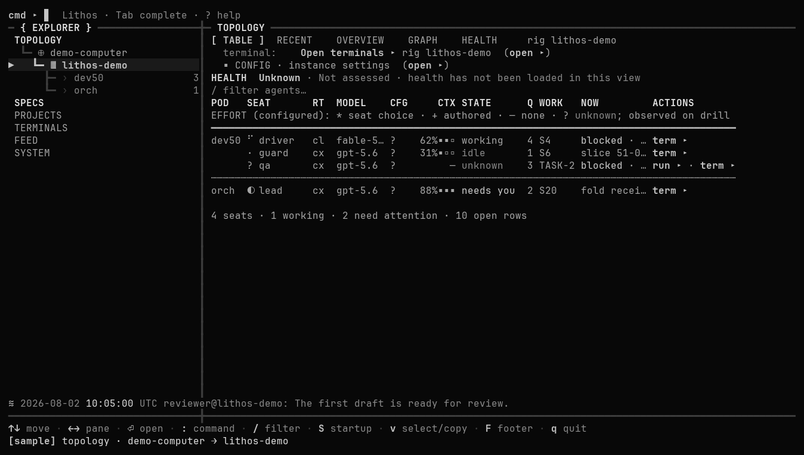
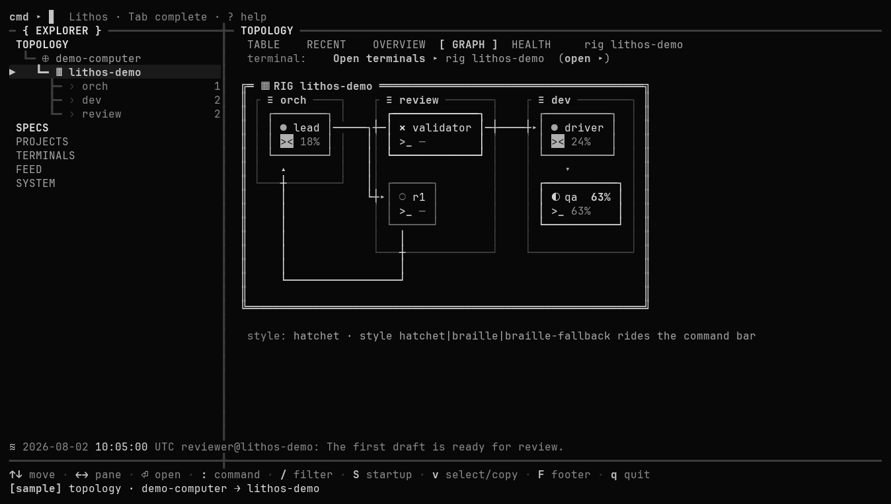
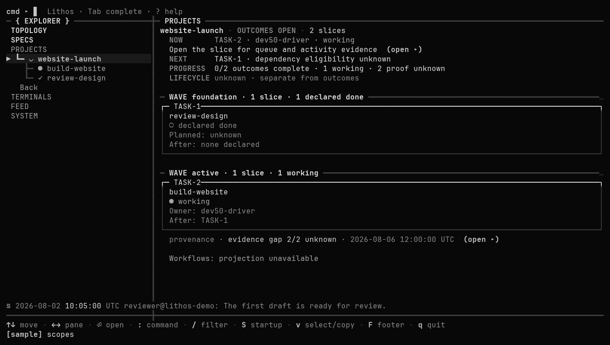

# Lithos

Lithos helps a team of AI assistants work together on a project. You describe what you want, and the team can divide the work, keep track of progress, and bring decisions back to you.

You can use it to build software, explore an idea, or maintain a project. The team keeps its work and conversations organized so you can return to them later. You choose which assistants to use and what they are allowed to do.

Lithos runs on your computer. It works with Codex and Claude Code; you need an account for at least one of them. Lithos runs on Mac, Linux, or Windows using WSL.

[Get started](docs/reference/lithos-getting-started.md) · [Technical reference](docs/reference/help.md) · [License](LICENSE)

## See Lithos

These example screens use sample data.

**Your team:** See what each assistant is doing and who needs your attention.

**Team map:** See how the assistants work together.

**Project progress:** Follow the work as it moves forward.

Lithos is based on [OpenRig](https://github.com/mvschwarz/openrig), an open-source project by mvschwarz and its contributors. Their work and license are credited in [NOTICE](NOTICE).
